<p align="center">
  
</p>

<p align="center">
  <a href="https://tauri.app/"></a>
  <a href="https://www.rust-lang.org/"></a>
  <a href="https://react.dev/"></a>
  <a href="https://www.typescriptlang.org/"></a>
  <a href="https://vitejs.dev/"></a>
  <a href="https://mui.com/"></a>
  <a href="https://github.com/adrienverge/openfortivpn"></a>
  
  
  
</p>

# FortiVPN GUI

Desktop VPN client for **FortiGate** (system [`openfortivpn`](https://github.com/adrienverge/openfortivpn)). The UI is **Tauri 2** (Rust), **React 19**, and **Material UI**. Profiles and groups use an **INI-style layout** under `~/.fortivpngui/`, compatible with **OpenFortiGUI** for import and day-to-day use.

Current release: **[0.5.0](docs/releases/v0.5.0.md)** — see also [0.4.0](docs/releases/v0.4.0.md), [0.3.0](docs/releases/v0.3.0.md), [0.2.1](docs/releases/v0.2.1.md), and [0.2.0](docs/releases/v0.2.0.md).

**Licence:** this repository is [MIT](LICENSE). Runtime dependencies (Tauri/WebKit, React, MUI, `openfortivpn`, etc.) have their own licences.

## Screenshots

PNG files live in [`docs/images/`](docs/images/).

### Dark

| Screenshot | Screenshot |
|:---:|:---:|
| 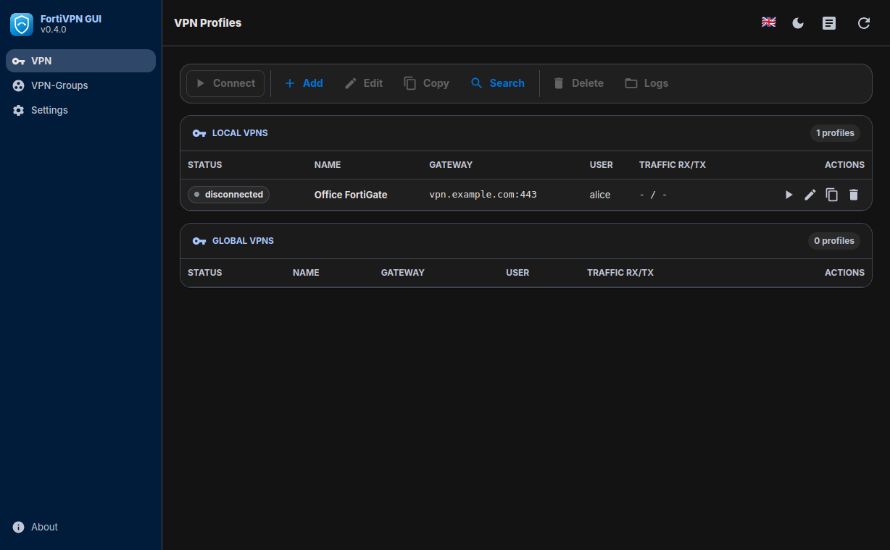 | 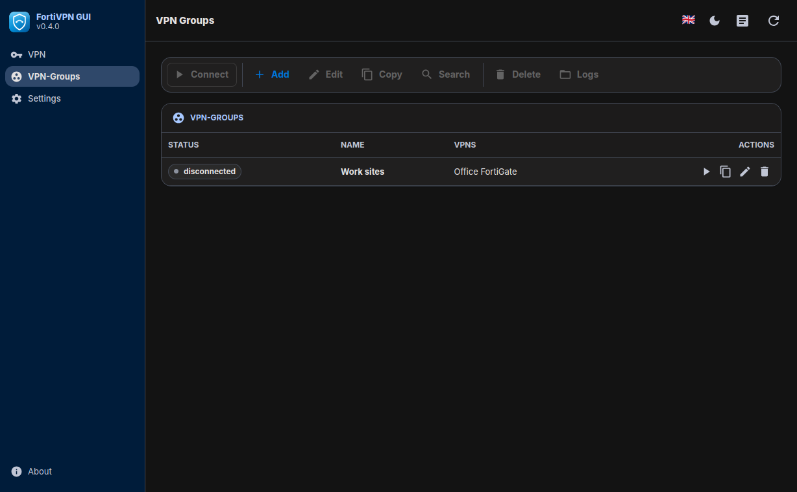 |
| 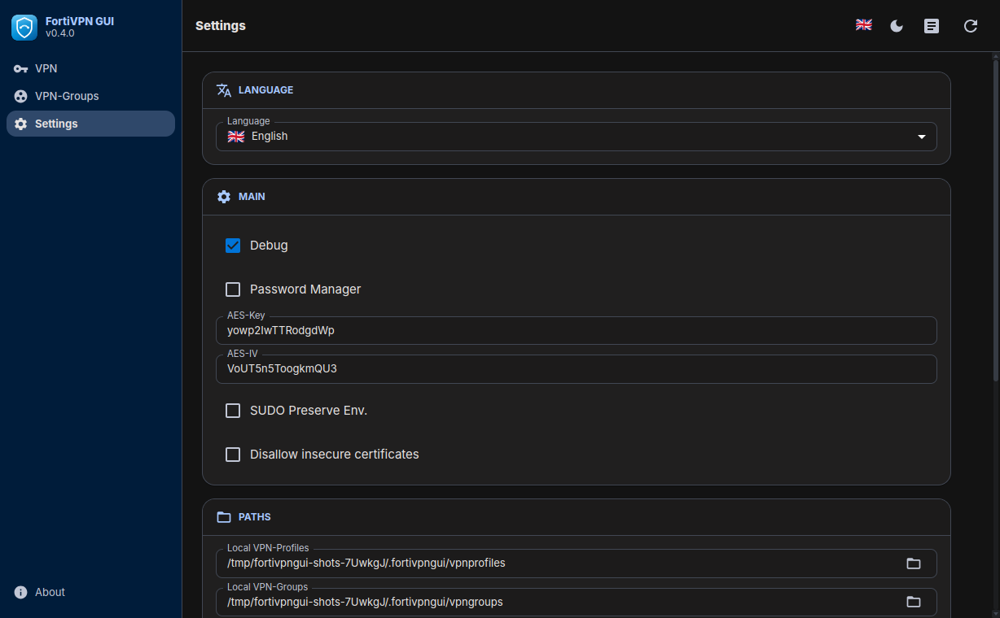 | 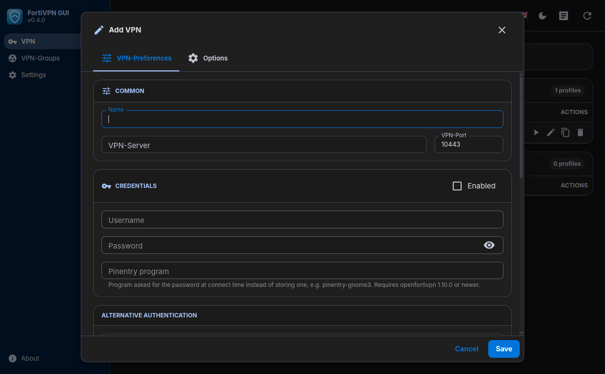 |
|  | 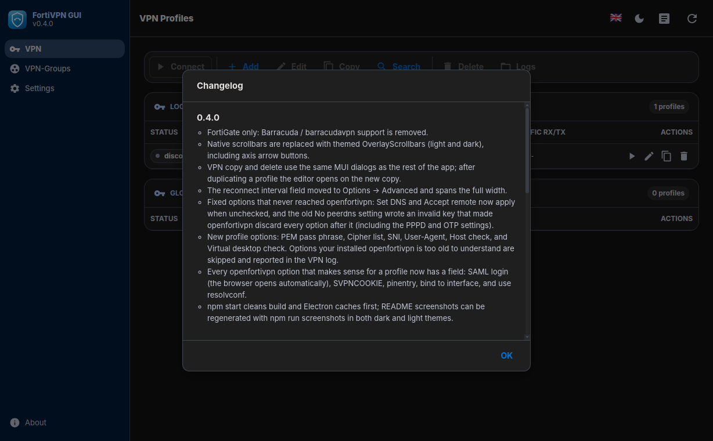 |
|  |  |

### Light

| Screenshot | Screenshot |
|:---:|:---:|
| 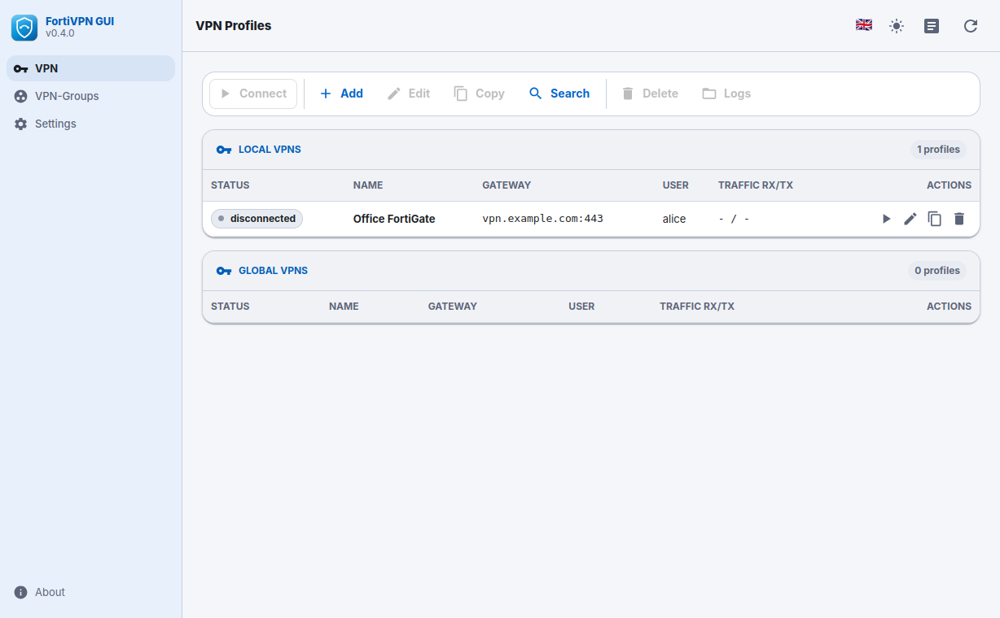 | 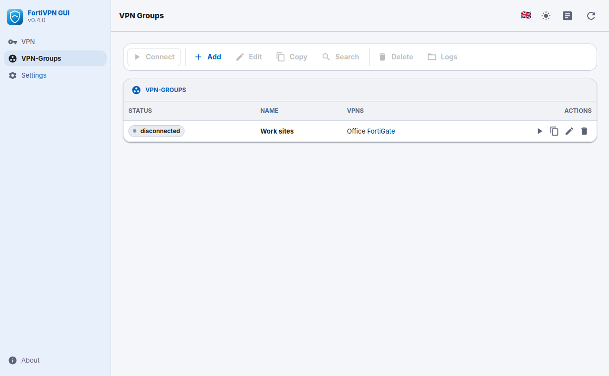 |
| 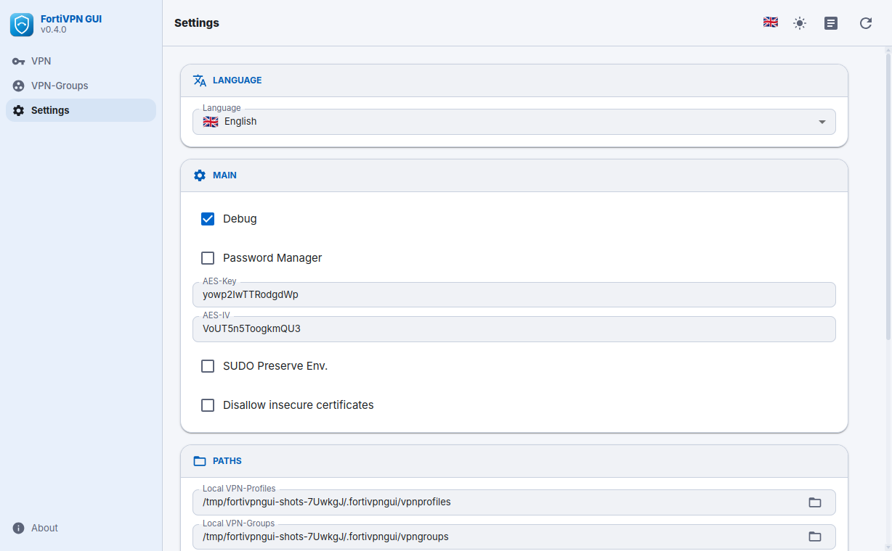 | 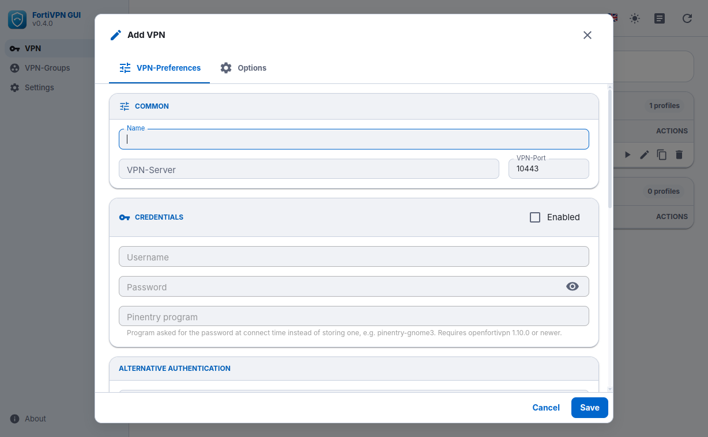 |
| 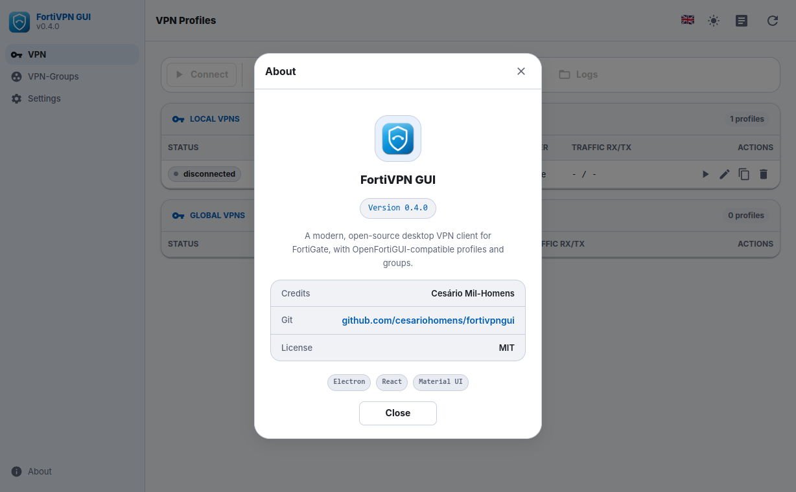 | 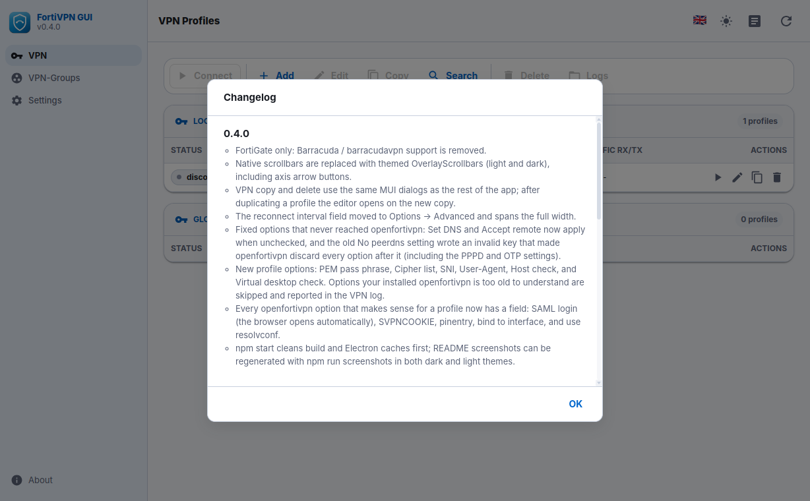 |
| 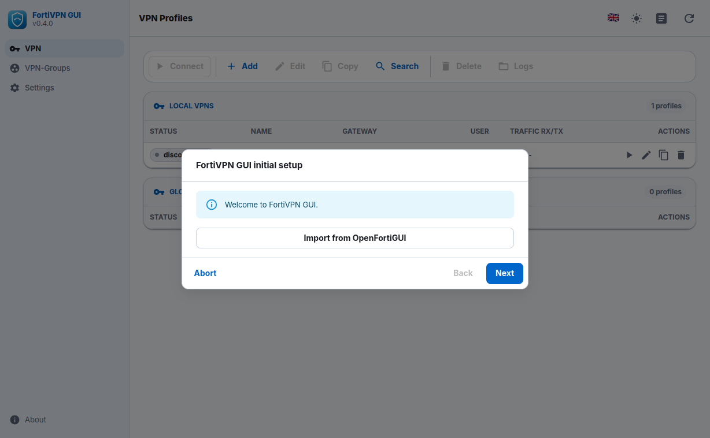 |  |

---

## Features

- **FortiGate only**: `sudo openfortivpn` with generated configs; options the installed binary cannot parse are skipped and logged (version / `--help` gating).
- **Full profile editor** for the useful `openfortivpn` surface: routes/DNS, reconnect interval (**Options → Advanced**), PPPD, SSL/TLS, certificates, gateway digests, SAML login, SVPNCOOKIE on stdin, pinentry, bind-to-interface, resolvconf, host check / virtual desktop / SNI / User-Agent.
- **OTP on stdin**, FortiToken Mobile push opt-out, optional gateway certificate prompt and `trusted-cert` handling, traffic stats, per-profile log files.
- **VPN groups**: connect/disconnect member profiles together.
- **No silent auto-reconnect**: a dropped tunnel raises a **warning dialog** with the detected cause; reconnecting is the user's call unless a **reconnect interval** (`persistent`) is set on the profile.
- **i18n**: English, Portuguese, Spanish, French, Italian, German.
- **Theme**: dark / light / system.
- **Tray** on Linux: quick connect/disconnect, open main window, Settings, quit.
- **Main window close** hides to tray; orphan temp configs under `TMPDIR/fortivpngui` are swept without stopping active tunnels.
- **Settings**: paths, AES key/IV, password manager (libsecret / keyring), notifications, search, theme/language, import/merge from OpenFortiGUI.
- **Packages**: `.deb` and `.rpm` via `npm run dist`.

---

## Requirements

| Context | Needs |
|--------|--------|
| **Development** | Node.js **20+**, npm, **Rust** (stable), system libs for Tauri (webkit2gtk-4.1, gtk3, librsvg, openssl) |
| **Runtime (Linux)** | `openfortivpn`, `ppp`, `sudo` |
| **.deb install** | Same as runtime; **`libsecret-1-0`** for optional OS keychain storage |
| **.rpm install** | Same as runtime; **`libsecret`** for optional OS keychain storage |

---

## Project layout

| Path | Role |
|------|------|
| `src-tauri/` | Rust/Tauri backend: IPC commands, tray, VPN runner, profiles/groups/settings/import |
| `src/renderer/` | React UI (`App.tsx`), `fvpn-bridge.ts`, i18n, Vite entry |
| `shared/` | Types and constants shared at build time |
| `resources/` | Packaged assets: `sudo/` template, `deb/` and `rpm/` maintainer scripts, icons |
| `docs/releases/` | Human-readable release notes |
| `docs/images/` | README screenshots |

---

## Development

```bash
npm ci
npm run tauri:dev     # Vite :5173 + Tauri with hot reload
npm run build         # build React renderer only
npm start             # debug build + run binary
```

Production-like local run:

```bash
npm run tauri:build   # release binary + deb/rpm under src-tauri/target/release/
```

---

## Configuration and data

- **Base directory:** `~/.fortivpngui/`
- **Main settings:** `~/.fortivpngui/main.conf` (INI: `main`, `paths`, `gui`)
- **Profiles:** local `~/.fortivpngui/vpnprofiles/`, global `/etc/fortivpngui/vpnprofiles/`
- **Groups:** `~/.fortivpngui/vpngroups/`
- **Logs:** configurable; VPN process logs under the configured tree

Paths are created on first run.

---

## Linux packages (.deb and .rpm)

```bash
npm run dist           # .deb + .rpm + AppImage
npm run dist:deb       # .deb only
npm run dist:rpm       # .rpm only
npm run dist:appimage  # AppImage only
```

Artifacts land under `src-tauri/target/release/bundle/` (`deb/`, `rpm/`, `appimage/`).

### Sudo (FortiGate)

`openfortivpn` must run as root. The packaged rule is in `resources/sudo/`. Tighten user/host in production if needed:

```text
# /etc/sudoers.d/fortivpngui
youruser ALL=(root) NOPASSWD: /usr/bin/openfortivpn *
```

The trailing **` * `** is important: the app invokes `sudo /usr/bin/openfortivpn -c /tmp/...` (plus flags).

### FortiGate OTP and alternative auth

- For **email/SMS OTP**, try **No FortiToken Mobile push** (`no-ftm-push`) and increase **OTP delay** if needed.
- **SAML login** (`saml-login`, openfortivpn ≥ 1.23): the app opens the `Authenticate at '…'` URL in the default browser.
- **SVPNCOOKIE** is sent with `--cookie-on-stdin` (never on argv).

---

## Import from OpenFortiGUI

Use **Settings → Import** or the first-run wizard to copy `~/.openfortigui/vpnprofiles/*.conf` and `vpngroups/*.conf` into `~/.fortivpngui/`.

---

## Changelog in the app

When you change in-app changelog content, bump **`CHANGELOG_REV`** in **both** [`shared/constants.ts`](shared/constants.ts) and [`src-tauri/src/config.rs`](src-tauri/src/config.rs).

---

## Third-party components

This app depends on **Tauri**, **Rust**, **React**, **Vite**, **Material UI**, **OverlayScrollbars**, and the system tool **openfortivpn**. Their licences apply to those components, not to this repo’s MIT-licensed source as a whole.
