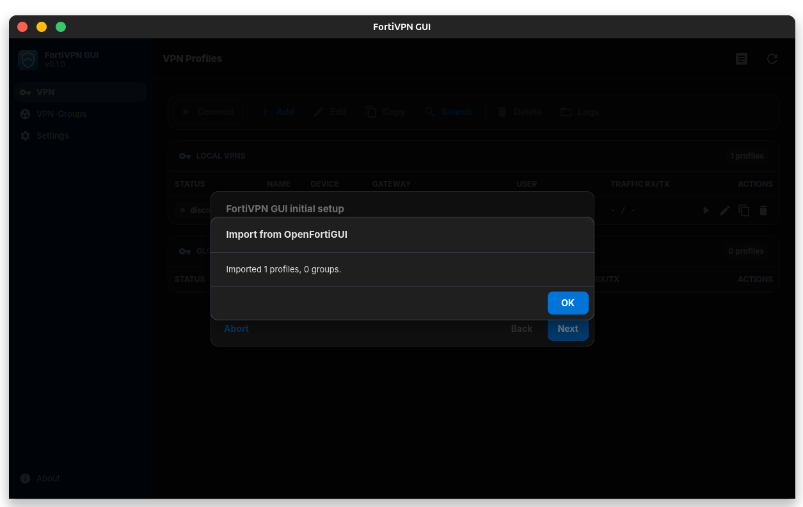
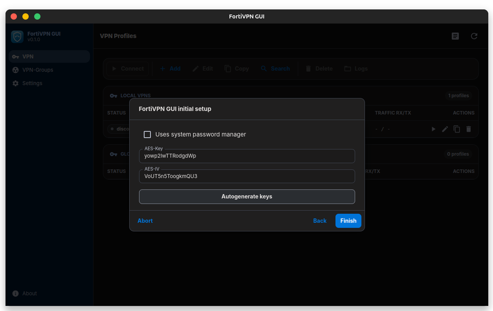
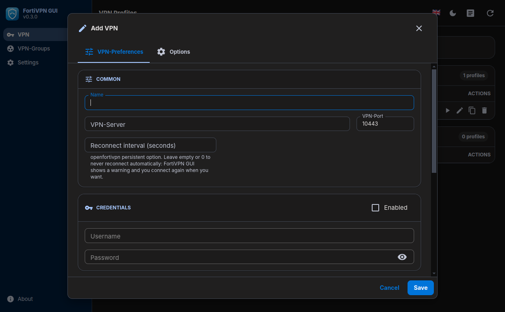
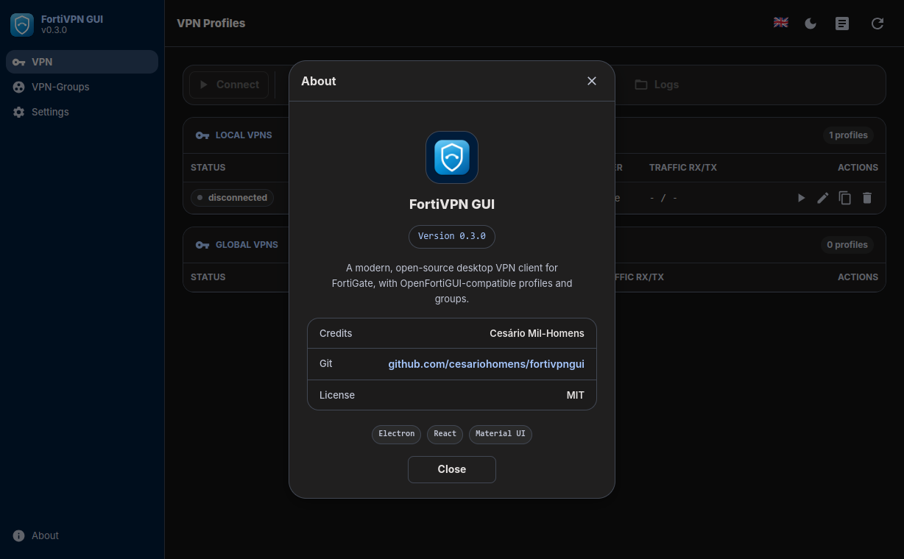
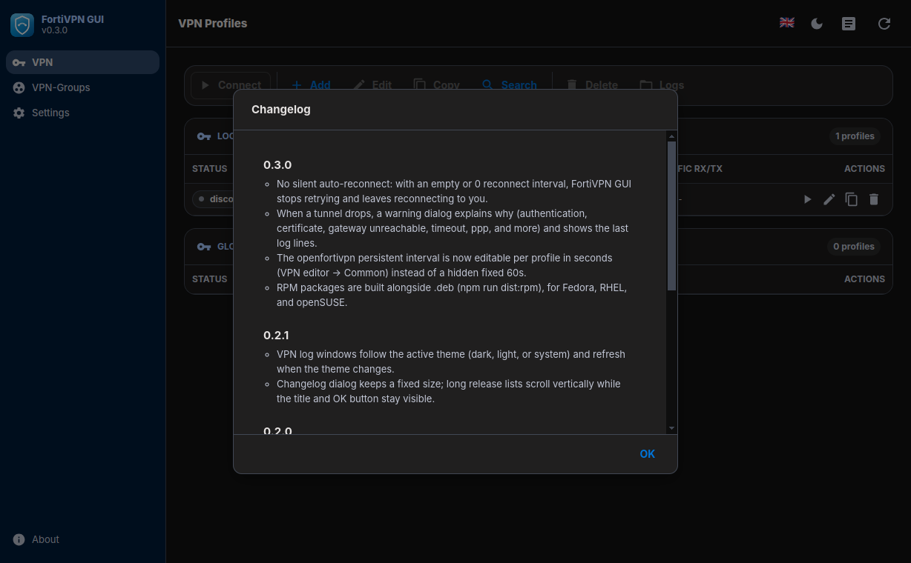
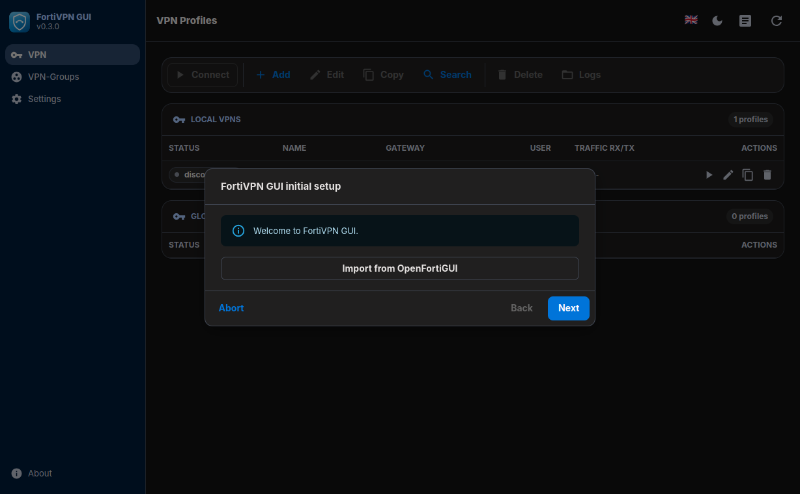
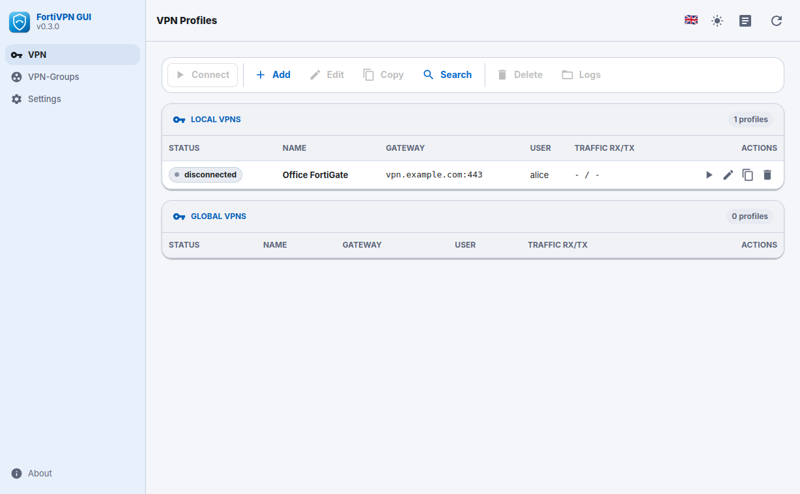

<p align="center">
  
</p>

<p align="center">
  <a href="https://www.electronjs.org/"></a>
  <a href="https://react.dev/"></a>
  <a href="https://www.typescriptlang.org/"></a>
  <a href="https://vitejs.dev/"></a>
  <a href="https://mui.com/"></a>
  <a href="https://nodejs.org/"></a>
  <a href="https://github.com/adrienverge/openfortivpn"></a>
  
  <a href="https://www.npmjs.com/package/ini"></a>
  <a href="https://www.npmjs.com/package/keytar"></a>
</p>

# FortiVPN GUI

Desktop VPN client for **FortiGate** (system [`openfortivpn`](https://github.com/adrienverge/openfortivpn)) and **Barracuda** (`barracudavpn`, optional). The UI is **Electron**, **React 19**, and **Material UI**. Profiles and groups use an **INI-style layout** under `~/.fortivpngui/`, compatible with **OpenFortiGUI** for import and day-to-day use.

**Licence:** this repository is [MIT](LICENSE). Runtime dependencies (Electron, React, MUI, `openfortivpn`, etc.) have their own licences.

## Screenshots

PNG files live in [`docs/images/`](docs/images/). Replace them anytime; the table below lists every image in that folder.

| Screenshot | Screenshot |
|:---:|:---:|
|  |  |
|  |  |
|  |  |
|  |  |

---

## Features

- **FortiGate** profiles: `sudo openfortivpn` with generated configs, OTP on stdin, optional gateway certificate prompt and `trusted-cert` handling, traffic stats, per-profile log files.
- **Barracuda** profiles: `barracudavpn` runner with temp config dirs and stdin OTP where supported.
- **VPN groups**: connect/disconnect member profiles together; status derived from members.
- **No silent auto-reconnect**: a dropped tunnel raises a **warning dialog** with the detected cause and the last log lines; reconnecting is the user's call unless a **reconnect interval** (openfortivpn `persistent`, in seconds) is set on the profile.
- **Tray** on Linux: quick connect/disconnect, open main window, Settings tab, quit (full quit stops VPN helpers and cleans temp files).
- **Main window close** hides to tray; **orphan** temp configs under `TMPDIR` / `fortivpngui` are swept without stopping active tunnels.
- **Settings**: paths, AES key/IV, password manager (**keytar** / libsecret), notifications, search, **theme** (dark / light / system, stored in `main.conf`), import/merge from OpenFortiGUI.
- **External links** (`http`, `https`, `mailto`) open in the **system default browser** (main window navigation is guarded in the Electron main process).

---

## Requirements

| Context | Needs |
|--------|--------|
| **Development** | Node.js **20+**, npm |
| **Runtime (Linux)** | `openfortivpn`, `ppp`, `sudo` for FortiGate; optional `barracudavpn` for Barracuda |
| **.deb install** | Same as runtime; **`libsecret-1-0`** for optional OS keychain storage |
| **.rpm install** | Same as runtime; **`libsecret`** for optional OS keychain storage |
| **Building .rpm** | `rpmbuild` (`rpm-build` on Fedora/RHEL, `rpm` on Debian/Ubuntu) |

---

## Project layout

| Path | Role |
|------|------|
| `electron/` | Main process: window, tray, IPC, VPN runners (`openfortivpn-runner`, `barracuda-runner`), profiles/groups/settings/import, preload bridge |
| `src/renderer/` | React UI (`App.tsx`), Vite entry |
| `shared/` | Types and constants shared at build time (`constants.ts` imports `package.json` for version and metadata) |
| `resources/` | Packaged assets: `sudo/` template, `deb/postinst.sh` & `deb/postrm.sh`, icons |
| `dist/` / `dist-electron/` | Build output (ignored by git); `npm run build` fills these |

---

## Development

```bash
npm ci
npm run build:electron   # compile main + preload TypeScript
npm run electron:dev     # Vite :5173 + Electron with hot reload
```

`npm start` and `npm run electron:dev` use **`--no-sandbox`** so Electron runs when `chrome-sandbox` is not setuid root (common after `npm install`). If you see *“The SUID sandbox helper binary was found, but is not configured correctly”*, either keep `--no-sandbox` or fix sandbox permissions once:

```bash
sudo chown root:root node_modules/electron/dist/chrome-sandbox
sudo chmod 4755 node_modules/electron/dist/chrome-sandbox
```

Debug the blank window: `FORTIVPN_OPEN_DEVTOOLS=1 npm start` and inspect the Console.

Production-like local run:

```bash
npm start    # npm run build && electron --no-sandbox .
```

---

## Configuration and data

- **Base directory:** `~/.fortivpngui/`
- **Main settings:** `~/.fortivpngui/main.conf` (INI: `main`, `paths`, `checks`, `gui` — includes `gui/theme_mode` = `dark`, `light`, or `system`)
- **Profiles:** local `~/.fortivpngui/vpnprofiles/`, global `/etc/fortivpngui/vpnprofiles/` (paths configurable in Settings)
- **Groups:** `~/.fortivpngui/vpngroups/`
- **Logs directory:** configurable; VPN process logs under the configured tree

Paths are created on first run (`initMainConfig` in the Electron main process).

---

## Linux packages (.deb and .rpm)

```bash
npm run dist       # .deb + .rpm
npm run dist:deb   # .deb only
npm run dist:rpm   # .rpm only (host needs rpmbuild / rpm-build)
```

Artifacts land in `release/` (large; distribute via **GitHub Releases** or similar, not necessarily inside git):

| Format | Artifact | Install |
|--------|----------|---------|
| **deb** | `fortivpngui_<version>_amd64.deb` | `sudo apt install ./fortivpngui_<version>_amd64.deb` |
| **rpm** | `fortivpngui-<version>.x86_64.rpm` | `sudo dnf install ./fortivpngui-<version>.x86_64.rpm` |

- **Depends (deb):** `openfortivpn`, `ppp`, `sudo`, `libsecret-1-0` (`package.json` → `build.deb.depends`).
- **Depends (rpm):** `openfortivpn`, `ppp`, `sudo`, `libsecret` (`package.json` → `build.rpm.depends`).
- **`postinst`** (`resources/deb/postinst.sh`, `resources/rpm/postinst.sh`): installs `/etc/sudoers.d/fortivpngui` from the unpacked template (`asarUnpack` for `resources/sudo/**` so the file exists on disk under `/opt/fortivpngui/...`), validates with `visudo -c`, adjusts `chrome-sandbox` setuid when present, refreshes desktop/icon caches. The RPM variant also runs `restorecon` for SELinux systems.
- **`postrm`** (`resources/deb/postrm.sh`, `resources/rpm/postrm.sh`): deletes `/etc/sudoers.d/fortivpngui` on real removal only — deb checks `remove`/`purge`, rpm checks `$1 = 0` — never on **upgrade**.

Maintainer scripts are kept as two sets because Debian and RPM pass different arguments to the hooks; keep them in sync when changing install behaviour.

`npm install` **postinstall** only runs `electron-builder install-app-deps` (rebuilds **keytar** for the current Electron); it does **not** install sudoers.

### Sudo (FortiGate)

`openfortivpn` must run as root. The packaged rule (broad, review before deploying) is in `resources/sudo/fortivpngui.sudoers`. Tighten user/host in production if needed:

```text
# /etc/sudoers.d/fortivpngui
youruser ALL=(root) NOPASSWD: /usr/bin/openfortivpn *
```

The trailing **` * `** is important: the app invokes `sudo /usr/bin/openfortivpn -c /tmp/...` (plus flags). A rule without arguments often does **not** match, and you get password prompts or odd OTP behaviour.

Inspect the installed drop-in: `sudo visudo -f /etc/sudoers.d/fortivpngui`.

### FortiGate OTP tips

For **email/SMS OTP**, the gateway may need token mode instead of FortiToken Mobile push. In the profile editor, try **“no FTM push”** (`no-ftm-push`) and, if the token is slow, increase **OTP delay** (`otp-delay`, seconds).

---

## Import from OpenFortiGUI

Use **Settings → Import** or the first-run wizard to copy `~/.openfortigui/vpnprofiles/*.conf` and `vpngroups/*.conf` into `~/.fortivpngui/`. You can also merge keys from `~/.openfortigui/main.conf` where supported.

---

## Changelog in the app

When you add or change changelog content shown to users, bump **`CHANGELOG_REV`** in **both** [`shared/constants.ts`](shared/constants.ts) and [`electron/config.ts`](electron/config.ts) so the renderer and main process stay aligned.

---

## Native module rebuild

**keytar** is compiled for Electron via `electron-builder install-app-deps` (the `postinstall` script in `package.json`). After changing Electron version, run `npm install` again so the native binary matches.

---

## Third-party components

This app bundles or depends on **Electron**, **React**, **Vite**, **Material UI**, **ini**, **keytar**, and system tools **openfortivpn** / **barracudavpn**. Their licences apply to those components, not to this repo’s MIT-licensed source as a whole.
